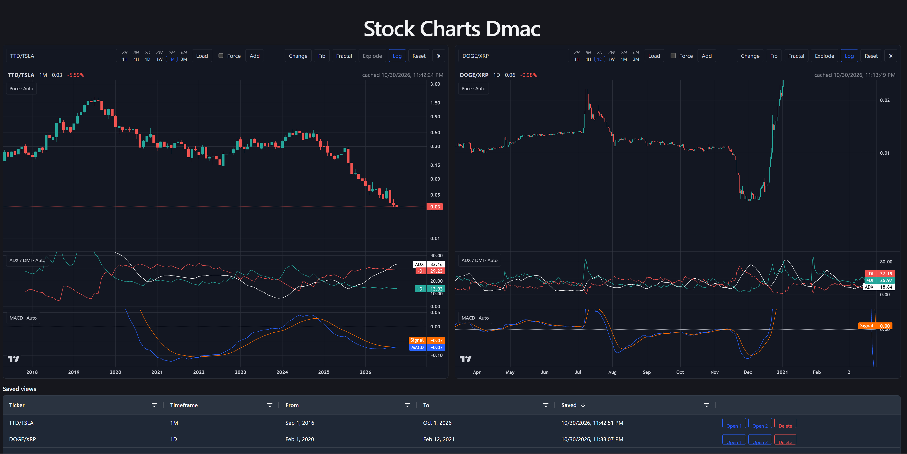

# Stock Charts Dmac



- `api/` – FastAPI backend (router → service → repository → model, SQLite via SQLAlchemy)
- `ui/` – React + TypeScript + Vite frontend

## Run the API

```bash
cd api
python -m venv .venv
.venv\Scripts\activate
pip install -r requirements.txt
uvicorn app.main:app --reload --port 8000
```

Docs: http://localhost:8000/docs

## Run the UI

```bash
cd ui
npm install
npm run dev
```

Open http://localhost:5173 — `/api` requests are proxied to the API on port 8000.
